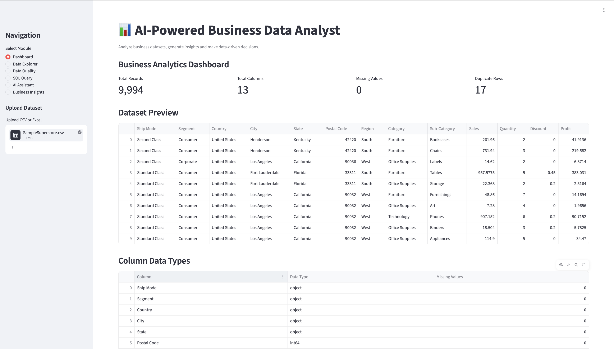
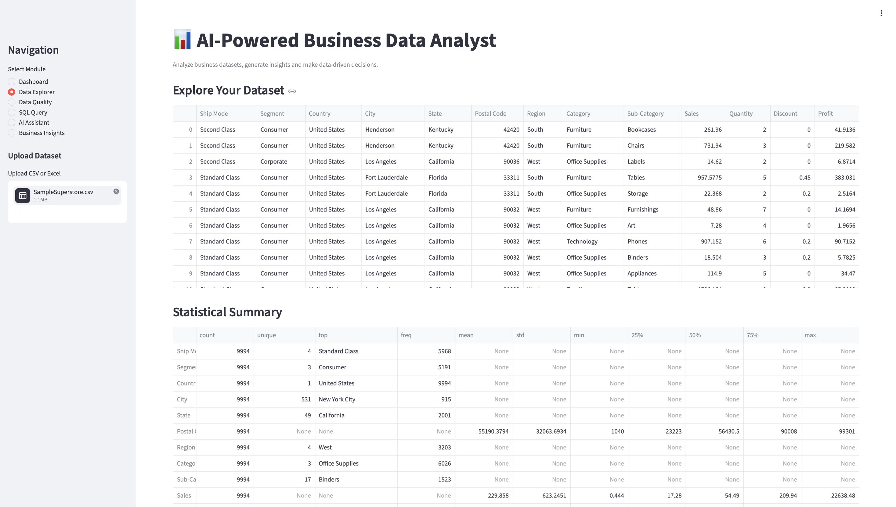
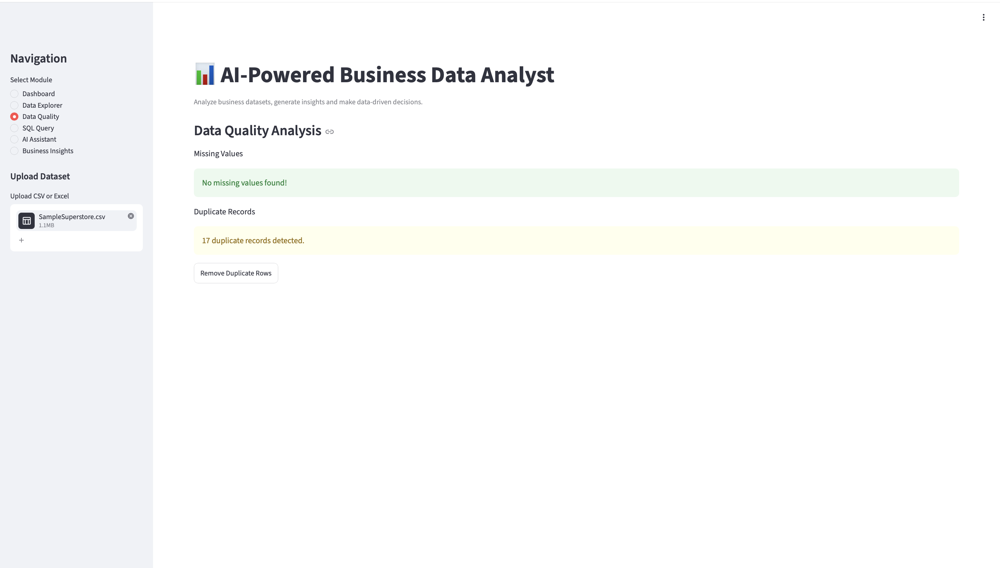
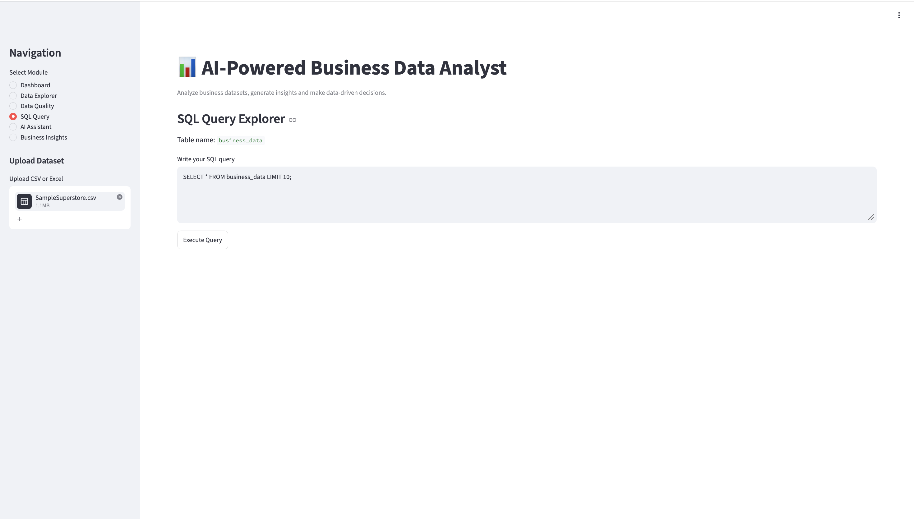
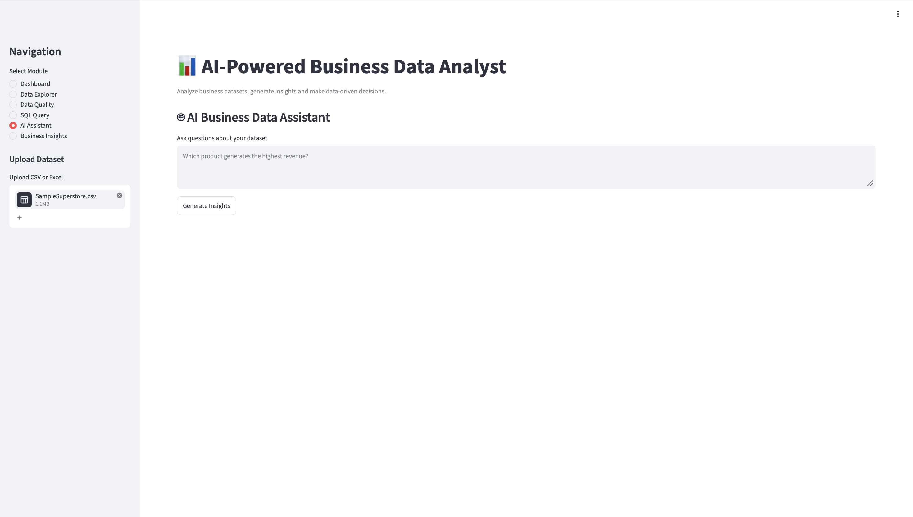
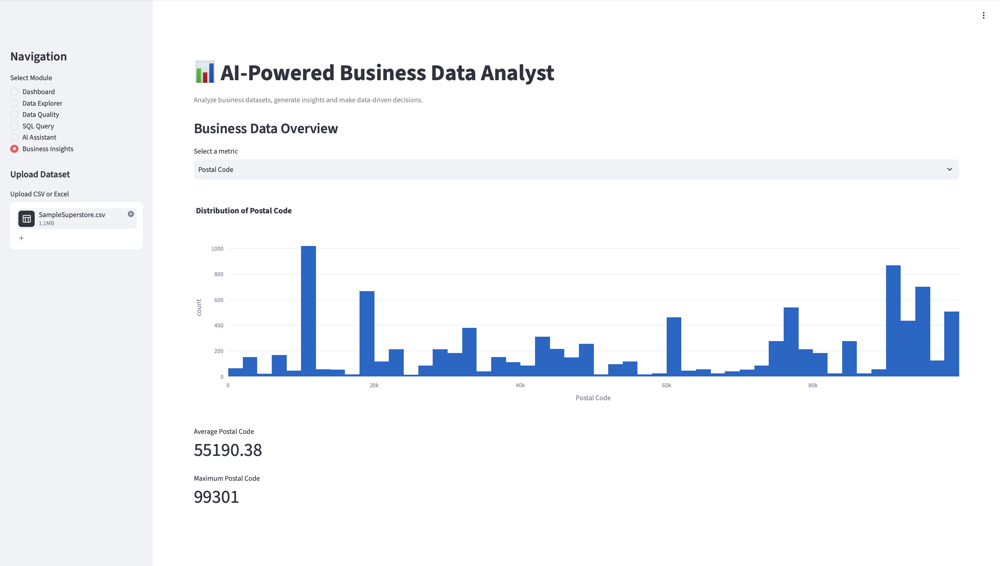

# 📊 AI-Powered Business Data Analyst

An interactive AI-powered business analytics application built to transform raw business datasets into meaningful insights. The application combines data analysis, SQL querying, data quality assessment, interactive visualizations, and Generative AI to simplify business data analysis.

---

## 📸 Application Screenshots

### 1. Dashboard


### 2. Data Explorer


### 3. Data Quality


### 4. SQL Query


### 5. AI Assistant


### 6. Business Insights


---

## ✨ Features

### 📊 Dashboard
- Interactive business analytics dashboard.
- Dataset overview and key performance indicators.
- Visual representation of business data.
- Quick access to important dataset statistics.

### 🔍 Data Explorer
- Explore uploaded datasets.
- View column information and data types.
- Generate descriptive statistical summaries.
- Inspect dataset records.

### 🧹 Data Quality
- Identify missing values.
- Detect duplicate records.
- Examine dataset quality.
- Understand potential data inconsistencies.

### 💻 SQL Query
- Execute SQL queries on uploaded datasets.
- Retrieve specific records.
- Perform data filtering and aggregations.
- Analyze datasets using SQL.

### 🤖 AI Assistant
- AI-powered interaction using Google Gemini.
- Ask questions about uploaded datasets.
- Generate natural-language explanations.
- Simplify complex data analysis.

### 📈 Business Insights
- Generate meaningful business insights.
- Identify important trends and patterns.
- Support data-driven decision-making.
- Obtain AI-generated recommendations.

---

## 🛠️ Technology Stack

| Category | Technologies |
|---|---|
| Programming Language | Python |
| Frontend Framework | Streamlit |
| Data Analysis | Pandas, NumPy |
| Data Visualization | Plotly |
| Query Language | SQL |
| Generative AI | Google Gemini API |
| Development Environment | Google Colab |
| Version Control | Git, GitHub |

---

## 🔄 Application Workflow

1. Upload a business dataset in CSV or Excel format.
2. Explore the dataset through the interactive dashboard.
3. Analyze records, columns, and statistical summaries.
4. Identify missing values and duplicate records.
5. Execute SQL queries to extract relevant information.
6. Interact with the AI Assistant to ask dataset-related questions.
7. Generate business insights and recommendations.

---

## 📂 Supported File Formats

- CSV (.csv)
- Excel (.xlsx)

The application allows users to upload their own datasets for interactive analysis.

---

## 📁 Project Structure

```text
AI-Powered-Business-Data-Analyst/
│
├── app.py
├── ai_assistant.py
├── sql_engine.py
├── requirements.txt
├── README.md
├── .gitignore
│
└── screenshots/
    ├── dashboard.png
    ├── data_explorer.png
    ├── data_quality.png
    ├── sql_query.png
    ├── ai_assistant.png
    └── business_insights.png
